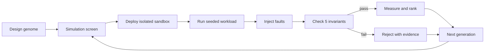
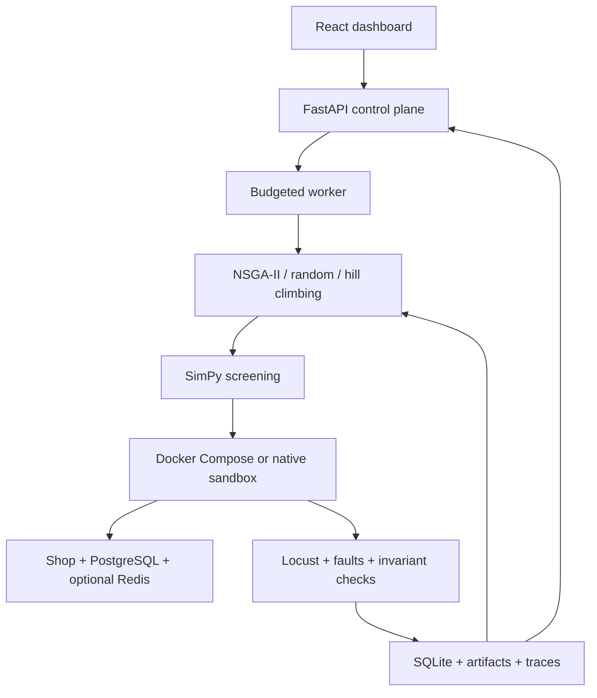

# DARWIN — Project Context

> **Snapshot:** 14 November 2026
> **Repository:** [github.com/udbhavnc7/DARWIN](https://github.com/udbhavnc7/DARWIN) (public, MIT)
> **Short version:** the ten-phase MVP is functionally complete. DARWIN is roughly **75% of the way to a production-ready release**; the remaining quarter is hardening, validation breadth, security, packaging, and CI — not missing core features.

This file is the single place to answer: *What is DARWIN, exactly? What has been built? How finished is it? What is still missing?*

---

## 1. What DARWIN is

DARWIN is a **local-first backend architecture lab** for one specific system: a checkout backend.

It generates supported configurations of that backend, deploys each candidate for real, measures it under seeded traffic and injected failures, rejects any candidate that violates defined business rules, and ranks the survivors by latency, CPU time, and recovery. Simulation is used only to decide which candidates deserve a real run.

In one sentence: **DARWIN is an evidence machine for backend architecture decisions, where correctness gates come before performance rankings.**

It is a working application, not a concept deck. The API, worker, sandboxes, fault injection, invariant oracle, simulator, search algorithms, dashboard, guided tour, evidence store, and replay path all exist and have been exercised.

---

## 2. The problem it solves

Ordinary architecture tools let you draw boxes and produce an estimate. That leaves three gaps:

1. **The estimate is not the system.** A diagram does not reveal queueing, contention, retry storms, or cleanup failures.
2. **Speed hides broken semantics.** A faster configuration can duplicate a payment or oversell stock; naive ranking rewards it.
3. **Results are not reproducible.** Without seeds, source snapshots, fault traces, and replay commands, a result cannot be defended later.

DARWIN closes all three: every candidate is deployed, every number comes from a recorded run, every rejection carries an invariant ID and a trace, and every result can be replayed.

---

## 3. Exact scope

DARWIN is deliberately narrow.

### The system under test

One checkout shop made of five services:

| Component | Role |
| --- | --- |
| Gateway | Routes catalog and checkout traffic to API replicas |
| Checkout / catalog API | Owns orders, catalog reads, idempotency keys, and request handling |
| Inventory | Reserves stock atomically; never below zero |
| Mock payment | Records captures against an idempotency key; no real money |
| PostgreSQL | Orders, inventory, payments, outbox, and ledgers |
| Redis (optional) | Catalog cache for cache-enabled genomes, and queue support where applicable |

### The search space

| Dimension | Supported values |
| --- | --- |
| API replicas | 1, 2, 3 |
| Catalog cache | Off, 10 seconds, 30 seconds |
| Notifications | Synchronous, queued through a transactional outbox |
| Retries | None, idempotent-only |
| Workloads | Normal, flash sale, checkout heavy |
| Fault families | Database delay/disconnection, service outage, ambiguous timeout/duplicate delivery |
| Request timeout | Fixed at 700 ms per downstream I/O operation, at most one retry; intentionally not a search control |

### The oracle

| ID | Rule |
| --- | --- |
| I-01 | At most one successful capture per payment idempotency key |
| I-02 | Confirmed quantities never exceed seeded stock |
| I-03 | Every confirmed order references a successful capture for its exact amount |
| I-04 | Replaying a key creates no extra business effects; a changed payload is rejected |
| I-05 | Completed notifications have receiver evidence; accepted jobs survive a specified worker failure |

### What DARWIN is not

- Not a generic cloud or Kubernetes optimizer
- Not a multi-tenant SaaS (the control plane assumes one trusted local operator)
- Not an LLM-driven system; the core loop works without a model
- Not a real payment processor; all payments are simulated
- Not an arbitrary code transformer; only the four typed controls vary
- Not a substitute for production load testing; results apply to this shop and this host

---

## 4. How a run works



1. A typed **genome** selects replicas, cache, notifications, and retries.
2. The **SimPy simulator** estimates performance and ranks candidates for promotion. Its output is labeled simulated and can never pass a gate.
3. A promoted candidate is **deployed** into an isolated Docker Compose project or a private native sandbox with fresh data.
4. **Locust** applies a seeded workload; the runner records latency samples, throughput, errors, CPU time, peak memory, and recovery.
5. **Faults** are injected: database latency/disconnection, service outage, ambiguous payment responses, duplicate delivery.
6. The **invariant oracle** reads recorded business state. A violation rejects the candidate regardless of speed.
7. **Search** (NSGA-II, random, or hill climbing) uses measured feedback to propose the next generation. Feasible candidates are ranked on a measured Pareto front.

Every run stores its configuration, source snapshot, seeds, manifests, logs, fault traces, artifact hashes, and a replay request.

---

## 5. How complete is it?

### Headline

| Measure | State |
| --- | --- |
| MVP phases | **10 / 10 complete** |
| Core user workflows | **All working locally** |
| Production readiness | **~75% (judgment, not a computed metric)** |
| Tests | **96 passing, 13 skipped** without PostgreSQL/Redis |
| Frontend production build | **Passing** |
| Docker acceptance | **21 / 21 repetitions passed** |

### Completion by area

Percentages are engineering estimates based on what is implemented, tested, and operated — not a formal score.

| Area | State | Estimate | What that means |
| --- | --- | ---: | --- |
| Domain model and contracts | Done | 100% | Typed genome, canonical hashing, versioned Pydantic contracts, rejection of unknown fields |
| Shop under test | Done | 95% | Five services, PostgreSQL, idempotency, atomic stock, outbox, seed/reset, ledger inspection; payments are simulated |
| Configuration controls | Done | 100% | Four controls change real deployment and request behavior |
| Experiment runner | Done | 90% | Native and Docker sandboxes, budgets, lifecycle, cancellation, cleanup, reruns |
| Measurement | Done | 90% | Seeded workloads, raw samples, p95, CPU, memory, paired repetitions |
| Faults and invariants | Done | 95% | Three fault families, five checkers, reproducible unsafe fixture |
| Simulator | Done, limited accuracy | 85% | SimPy model calibrated to 27.0% mean p95 error across nine holdouts; some misses are large |
| Search | Done, validation thin | 85% | NSGA-II, random, hill climbing, lineage, Pareto ranking; only one seed per strategy validated |
| Dashboard | Done | 95% | Five workspaces, evidence inspection, reruns, tour, themes, responsive down to 360 px; formal accessibility audit pending |
| Evidence and replay | Done | 90% | SQLite history, artifact digests, source snapshots, export bundle, replay instructions |
| Docker path | Done | 85% | Full acceptance passed; the accepted search ended with an empty Pareto front |
| Native path | Done on Windows | 80% | Windows resource jobs and private PostgreSQL clusters; not cross-platform |
| Tests | Strong locally | 80% | 96 pass, 13 integration tests skip without services; no CI |
| Security and multi-user | Not started | 10% | Loopback-only trusted operator; no authentication or project isolation |
| Packaging and distribution | Partial | 40% | Manual three-terminal setup; no installer or containerized control plane |
| Documentation | Strong | 90% | Full README, contracts, phase records; a few early-phase status lines are stale |
| Demo assets | Partial | 70% | Evidence bundles exist; the recorded walkthrough predates the current interface |
| CI and release automation | Not started | 0% | No workflow pipeline; validation is run manually |

**Why 75% and not 100%:** the MVP is feature-complete for the defined scope, but a production release also needs authentication, CI, packaging, multi-host validation, cross-platform support, and refreshed demo assets. Those are real work, not polish.

---

## 6. What works today

### In the dashboard

- **Overview** with the product tour and environment readiness
- **Architecture** with live topology, simulation, Compose export, and hand-off to Experiments
- **Experiments** for smoke checks, benchmarks, fault verification, and request validation
- **Search** for NSGA-II, random, and hill-climbing runs with lineage, gates, and the Pareto plot
- **Demo shop** where the same request key can be replayed against the real local shop
- Five themes, persisted per browser
- A five-step product tour at `?tour=1`, from the sidebar, or from the overview

### From the CLI and API

- Start, list, inspect, cancel, and rerun experiments
- Stream lifecycle events over WebSocket or replay them by sequence
- Inspect candidates, evaluations, violations, and downloadable artifacts
- Simulate a genome with explicit calibration scope
- Export a digest-verified evidence bundle
- Run the Docker acceptance suite and equal-budget search comparison
- Reset, reconcile, drain, and inspect the local demo shop

### Verified in the current environment

| Check | Result |
| --- | --- |
| Backend suite | 96 passed, 13 skipped |
| Frontend build | Passed, including `tsc --noEmit` |
| Docker acceptance | 21 of 21 repetitions passed, including cleanup |
| Unsafe fixture | Rejected for I-01 in all repetitions, with three payment effects per key |
| Product tour | 10 of 10 interaction checks passed |
| Search comparison | NSGA-II + simulation best at 273.9 ms median p95; single seed per strategy |
| Simulator calibration | 27.0% mean absolute p95 error across nine held-out repetitions |
| Responsive layout | Verified at 1440, 900, 430, 390, and 360 px |

---

## 7. What is still missing or risky

### Priority 0 — required before any shared deployment

| Gap | Why it matters |
| --- | --- |
| No authentication or authorization | Anyone who can reach the API can start expensive experiments and read evidence |
| No project or tenant isolation | One control plane, one artifact root, one operator |
| No CI pipeline | Regressions are caught only when someone remembers to run tests |
| Single-seed search validation | The algorithm ordering is evidence for these runs, not a general claim |

### Priority 1 — required for a credible v1

| Gap | Why it matters |
| --- | --- |
| 13 integration tests skip by default | PostgreSQL/Redis behavior is unverified without manual service setup |
| Docker search produced an empty Pareto front | Both promoted candidates missed a recovery window; needs a larger budget |
| Native fault adapter is Windows-only | Linux users must use Docker for measured/fault runs |
| Manual three-terminal setup | No installer, no containerized control plane, no service manager |
| Recorded demo is outdated | It shows an earlier interface than the current dashboard |
| One host, one environment | No multi-host or cross-platform performance validation |

### Priority 2 — cleanup and polish

| Gap | Why it matters |
| --- | --- |
| Early docs contain stale status lines | `docs/ARCHITECTURE.md` and `docs/PHASE_2.md` still describe Docker acceptance as open |
| 528 kB Three.js chunk | Vite warns above 500 kB; the scene is lazy-loaded, so the dashboard still loads |
| No formal accessibility audit | Keyboard and focus behavior are implemented, but no WCAG review has been recorded |
| No contributor guide or code of conduct | Fine for a solo project; needed for outside contributors |
| Cloud/Kubernetes adapters | Explicitly out of MVP scope |
| Optional LLM explanations | Explicitly out of MVP scope |

---

## 8. Architecture at a glance



| Path | Responsibility |
| --- | --- |
| `backend/darwin/contracts.py` | Genome, request, experiment, candidate, evaluation, metrics, violation, artifact, event contracts |
| `backend/darwin/experiments.py` | Experiment lifecycle, worker, budgets, persistence |
| `backend/darwin/fault_suite.py` | Fault schedules, recovery measurement, invariant orchestration |
| `backend/darwin/invariants.py` | I-01 through I-05 against recorded business state |
| `backend/darwin/simulator.py` | SimPy screening model |
| `backend/darwin/search.py` | NSGA-II, random search, hill climbing, lineage, Pareto ranking |
| `backend/darwin/shop/` | Gateway, catalog/checkout API, inventory, payment, worker, ledger CLI |
| `frontend/src/` | Dashboard, React Flow topology, Three.js art, tour, themes, responsive UI |
| `tests/` | Contract, architecture, experiment, fault, performance, search, shop, Docker checks |
| `docs/` | Scope, architecture, contract semantics, phase acceptance records |
| `scripts/` | Validation, evidence export, shop runner, Toxiproxy setup, demo rendering |

---

## 9. Where the evidence lives

| Evidence | Location |
| --- | --- |
| Run history and manifests | `artifacts/experiments/` (Git-ignored) |
| Search reports | `artifacts/validation/` (Git-ignored) |
| Docker acceptance | `artifacts/docker-acceptance*/` (Git-ignored) |
| Evidence bundles | `artifacts/demo/*.zip` (Git-ignored) |
| Committed acceptance narratives | `docs/PHASE_1.md` … `docs/PHASE_10.md`, `docs/DOCKER_ACCEPTANCE.md` |

A fresh checkout has the code and the written results, but not the historical run artifacts. That is intentional: evidence is produced locally and exported on demand.

---

## 10. How to verify this status yourself

```powershell
# Fast suite: expect 96 passed, 13 skipped in a clean local environment
.\.venv\Scripts\python.exe -m pytest -q

# Type-check and production build
npm --prefix frontend run build

# Full Docker acceptance (requires a Linux Docker engine)
.\.venv\Scripts\python.exe scripts/validate_docker.py --output artifacts/docker-acceptance

# Equal-budget search comparison (requires native prerequisites)
.\.venv\Scripts\python.exe scripts/validate_searches.py --output artifacts/validation/search-comparison.json
```

To exercise the UI:

1. Start the API, Vite dev server, and demo shop as described in the [README](README.md#quickstart).
2. Open `http://127.0.0.1:5173/?tour=1`.
3. Run a smoke experiment from **Experiments**.
4. Open a completed search in **Search** and inspect lineage and the Pareto plot.
5. Place and replay an order in **Demo shop**.

---

## 11. Phase history

| Phase | Outcome |
| --- | --- |
| 1 | Scope, contracts, repository layout, local scaffold |
| 2 | Baseline shop with gateway, API, inventory, payment, PostgreSQL, seed/reset, idempotency |
| 3 | Typed genome and four controls with real deployment effects and Compose generation |
| 4 | Experiment runner, SQLite evidence, events, artifacts, cancellation, reruns |
| 5 | Seeded workloads and real performance measurements with repetitions |
| 6 | Fault injection and the five-invariant oracle, including the unsafe fixture |
| 7 | Calibrated SimPy simulator used for screening only |
| 8 | NSGA-II, random, hill climbing, lineage, measured Pareto ranking |
| 9 | Dashboard with evidence inspection, React Flow topology, search history, responsive UI, guided tour |
| 10 | Equal-budget validation, Docker acceptance, honest negative results, evidence bundles |

---

## 12. Glossary

| Term | Meaning |
| --- | --- |
| **Genome** | The four-control configuration of the shop |
| **Candidate** | A genome proposed by a search or supplied manually |
| **Evaluation** | One candidate under one workload/fault schedule and repetition |
| **Repetition** | One isolated run within an evaluation; three are required for a measured result |
| **Gate** | Deployment, invariant, error, and resource checks that decide feasibility |
| **Feasible** | Every required repetition passed all executed gates |
| **Simulated** | Produced by the SimPy model; never a measured winner |
| **Measured** | Produced by a real deployed run with recorded evidence |
| **Pareto front** | Feasible candidates not dominated on latency, CPU time, and recovery |
| **Censored recovery** | Recovery was not observed inside the measurement window; not treated as zero |
| **Evidence bundle** | A digest-verified archive of results, source, traces, and replay instructions |

---

## 13. Notes for future contributors and AI assistants

- Read this file and the [README](README.md) before changing behavior.
- **Never present simulated output as measured evidence.** The separation is a core product guarantee.
- **Never let performance outrank a failed invariant.** I-01 through I-05 are hard gates.
- Preserve negative results. An empty Pareto front or an unimplemented baseline is still evidence.
- Run `pytest` and `npm --prefix frontend run build` before committing.
- `artifacts/` and `.runtime/` are Git-ignored; do not move historical runs into committed docs.
- Keep the public API contracts backward compatible or version them explicitly.
- When a phase changes, update its document rather than leaving a stale status line.
- Use the Docker path for portable measured and fault runs; the native fault adapter is Windows-specific.
