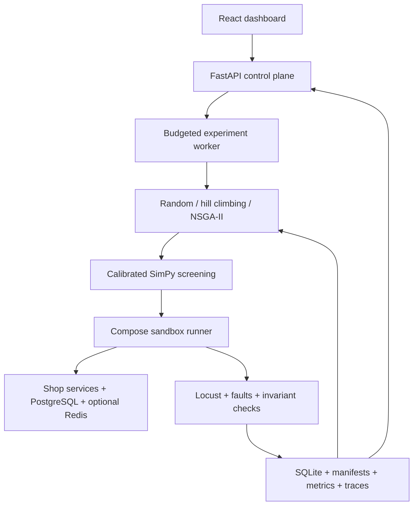

# Architecture and fixed MVP scope

DARWIN uses a single Python control-plane application and local worker. Modules do not need separate microservices. React communicates with FastAPI; SQLite and an artifact directory will store evidence. Each tested shop configuration runs in an isolated Compose project.

Through Phase 4, the worker runs manually supplied configurations, persists smoke results and events in SQLite, and retains artifact files. Local native execution has been verified; Docker acceptance remained open at this phase and was closed in Phase 10 (see [DOCKER_ACCEPTANCE.md](DOCKER_ACCEPTANCE.md)). Load testing, adversarial verification, simulation, and search were later phases.

## Shop behavior decisions

Baseline: one stateless API replica, catalog cache disabled, synchronous notifications, idempotent-only retries. Timeout is fixed at 700 ms per downstream I/O operation, with at most one retry after 100 ms for eligible transient failures. Checkout schedules downstream attempts within a two-second budget; strict end-to-end cancellation is not implemented yet. An ambiguous write outcome must be resolved using the same persisted idempotency key; never create a new capture key to retry.

Catalog cache stores descriptive catalog data only. Cached data expires after the selected 10 or 30 seconds. Checkout reads authoritative price and inventory. Payment state and stock availability are not served from that cache.

Queue decision: PostgreSQL transactional outbox, polled by a notification worker. Enqueue is atomic with confirmation; notification delivery is at least once with a unique job key and idempotent mock receiver. Acknowledgment follows successful delivery. After a worker restart, unacknowledged jobs can be reclaimed. Tests drain for up to 30 seconds after recovery. Checkout success means the order is confirmed; in queued mode notification may remain pending. In synchronous mode notification is attempted before the response, but notification failure does not undo a confirmed order. The outbox retains delivery work in both modes.

Inventory reservations are atomic and cannot take available stock below zero. Payment and order services keep explicit pending, confirmed, and failed states. Faults may leave pending work for reconciliation; an order is confirmed only after capture is durably verified. Detailed transitions and compensation are implemented and tested in Phase 2.

## Business invariants

| ID | Meaning | Evidence |
| --- | --- | --- |
| I-01 | At most one successful capture per payment idempotency key | Capture ledger grouped by key |
| I-02 | Confirmed quantities never exceed seeded stock, and reservations do not oversell | Inventory/order ledger and concurrent history |
| I-03 | Every confirmed order references a successful capture for its exact amount | Order-payment join |
| I-04 | Repeating a request key creates no additional order, reservation, capture, or notification effect; changed payload with that key is rejected | Replay history and before/after ledgers |
| I-05 | Completed jobs have receiver evidence; accepted jobs survive the specified transient worker failure and deliver within the recovery/drain window | Outbox, receiver ledger, worker restart trace |

Unsafe retries are confined to an explicitly selected seeded-bug fixture in Phase 6, excluded from the public normal genome contract.

## Scope boundary

One shop, four controls, three workload profiles, three fault families, five invariants. Core loop works without an LLM. Cloud/Kubernetes adapters, arbitrary code transformations, real payments, and additional optimization approaches are later extensions.

